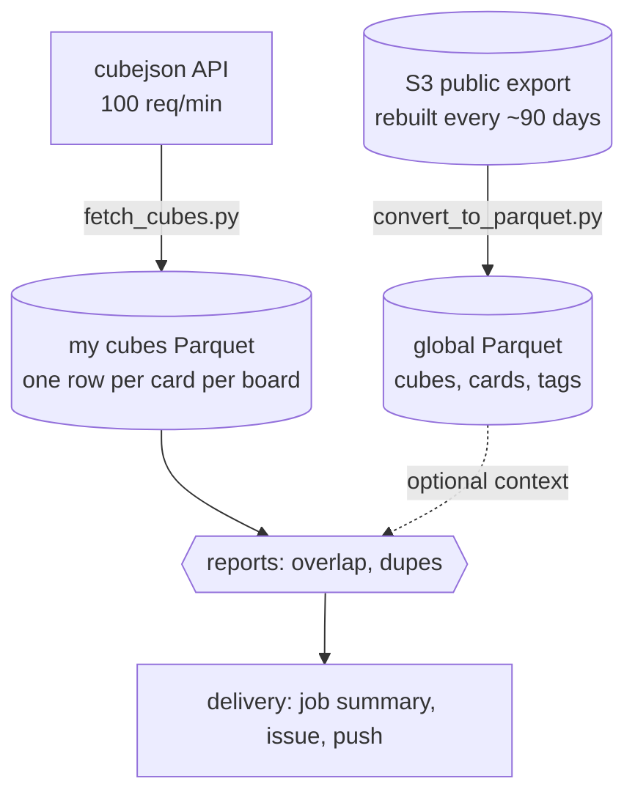

# Roadmap: where this is and where it could go

> **Chat summary: pending.** `llm-convo.json` is still the 2-byte placeholder `x`, so there is no
> transcript and no summary of that chat yet. Everything below comes from the repo, the real data and
> CubeCobra's source, not from the chat. Push the real file and I'll add `docs/llm-convo.md` (full
> transcript), a "what the chat decided" section here, and reconcile the two.

**TL;DR**
- Done (open PRs): converter fixed (#4); Python scaffolding + snapshot of my cubes (#5).
- Missing: the two reports (overlap, dupes). Blocked on three answers from you: what "uniques" means,
  what counts as "the same card", which boards count (decisions 1-3 below).
- Also missing: the real `llm-convo.json`.

Detailed how-to (repo layout, order, libs, formats, links) lives in
[implementation-ideas.md](implementation-ideas.md). This page is the big picture.

## What this project is (my reading)
Two tracks that share tooling but not data:

| | question it answers | source | state |
|---|---|---|---|
| **Global** | what does the whole CubeCobra world look like? (popularity, tags, co-occurrence) | public S3 export, rebuilt every ~90 days | converter fix in #4, no consumer yet |
| **Mine** | are my cubes tidy? (overlap with "uniques", dupes), weekly | `cubejson` API | snapshot to Parquet in #5, **reports not written** |

Not goals for now: recommenders or ML (CubeCobra ships its own), draft picks (2+ GB per 1000 files), a web UI.

## Map

## Facts that shape the design (checked, not assumed)
- **Export cadence = ~90 days.** CubeCobra's monitor re-runs the export when the last successful one is
  older than 90 days. Last one: 2026-07-20, so the next is due about now. The `cards/*` files are older
  (2026-05-20). A quarterly cron fits; polling weekly and skipping unchanged files fits better.
- **`cubes.json` = public cubes, mainboard only.** No maybeboard, no unlisted or private cubes. It
  cannot feed the dupes report (needs maybeboard), so the personal track must use the API.
- **Card numbers are positions, not ids.** Each card in `cubes.json` is an index into
  `export/indexToOracleMap.json` (-1 = unknown or custom: 0.08% of slots). The `cards/*` files use a
  different list (`cards/indexToOracle.json`) built two months earlier: 840 fewer entries, diverging at
  index 55. **Never mix the two index spaces.** (This is the "MISMATCH" line in the sync workflow.)
- **`cubejson` API:** 100 requests/min per IP, open CORS, private cubes are invisible, and
  `?date=<unix ms>` returns the cube as of that date (checked: 180 days back differs by 76 cards).
  So week-over-week diffs don't need snapshots we store ourselves.
- **Time zone:** GitHub cron is UTC only. The tz database in the sandbox this was written in (tzdata 2026c) says Alberta stops
  changing clocks on 2026-11-01 and stays on UTC-6, so Mon/Wed 16:00 and Sat 08:00 local are 22:00 and
  14:00 UTC all year and no DST handling is needed. You live there, so tell me if that's wrong.
- **Upstream quirks we already hit:** one leaked Mongo ObjectID in `following` (fixed in #4); the
  export code does `index || -1`, which also turns index 0 into -1.
- **Cost:** global track 750 MB JSON -> 235 MB Parquet (201 MB zipped artifact), 77 s end to end.
  Personal track: 20 s, 109 KB.

## Decisions to make
The first three block the reports, the fourth blocks delivery; the rest can wait. My lean in *italics*.

1. **What is "uniques"?** Only you know. My three guesses:

   | reading | "in a cube but not in uniques" means | "uniques: across all >1 copy" means |
   |---|---|---|
   | A. master list of every card I own | cards I forgot to add to the master list | trivial: master list should be singleton |
   | B. cards I own exactly one copy of | cards that are *not* single-copy | a single-copy card sits in 2+ cubes: conflict |
   | C. cube of cards allowed nowhere else | normal cards, fine | a uniques card also in another cube: violation |

2. **Card identity.** Oracle id (any printing) vs exact printing vs name. *Oracle id for reports; keep
   the printing column for "owned" tracking.*
3. **Which boards count.** README implies: overlap = mainboards, dupes = mainboard vs maybeboard and
   copies in maybeboard. *Follow the README, make it a config switch.*
4. **Where reports go.** Job summary (zero setup) / issue with an @mention (the GitHub app pings your
   phone) / ntfy push / Quarto page on GitHub Pages / email. *Job summary + issue first, Pages later.*
5. **History.** Store weekly snapshots, or lean on `?date=` time travel. *Don't store anything yet.*
6. **Keep the global track?** It has no consumer. *Keep (77 s, free) but build nothing on it until a
   question needs it; add change detection so it doesn't redo identical data.*
7. **Dataframe library.** pandas works now. Polars or Ibis read closer to dplyr. DuckDB converted the
   450 MB `cubes.json` about 3.5x faster than pandas in my test, at similar RAM, but guesses column
   types badly (see implementation-ideas). *Stay on pandas until the global track gets a consumer.*
8. **Tooling.** pip + requirements.txt today. *Add uv + ruff when a third script appears, not before.*
9. **Private cubes.** The API can't see them. *Make them unlisted: still fetchable by id, just not listed.*

## Suggested order
1. Merge #4 (converter fix) and #5 (Python scaffolding + cube snapshot). Follow-up: make the sync
   workflow install from `requirements.txt` too.
2. Answer decisions 1-4 (1-3 first).
3. One PR: the two reports as functions over `my_cubes_cards`, with tests on small fixtures.
4. One PR: delivery (decision 4) and switching the schedule on (the cron lines already sit, commented
   out, in `my-cubes.yml`).
5. Optional: change detection for the global export; first real question on the global data.
6. Housekeeping when it hurts: uv, ruff, Dependabot grouping.

## Gotchas to plan for
- Scheduled workflows are delayed under load, and **GitHub disables them after 60 days without repo
  activity** in public repos. Either keep committing, or add a keep-alive.
- 3 runs a week is noisy if nothing changed. *Report only when there is something to act on.*
- The API shape can change. Keep a recorded real response as a test fixture.

## Pushback on the original idea (you asked for it)
- **The global Parquet pipeline is not a prerequisite for the weekly reports.** Separate tracks. Don't
  let the big one hold up the small one.
- **Parquet for ~100 KB of personal data is overkill**, CSV would do. Keep it anyway: types survive and
  it matches the global track.
- **R is a good fit for the reporting layer** (tidyverse, gt, Quarto). Python for ETL and R for reports
  is a legitimate split. If the goal is simply "one language", Python is fine too; this is a flag, not
  an objection.
